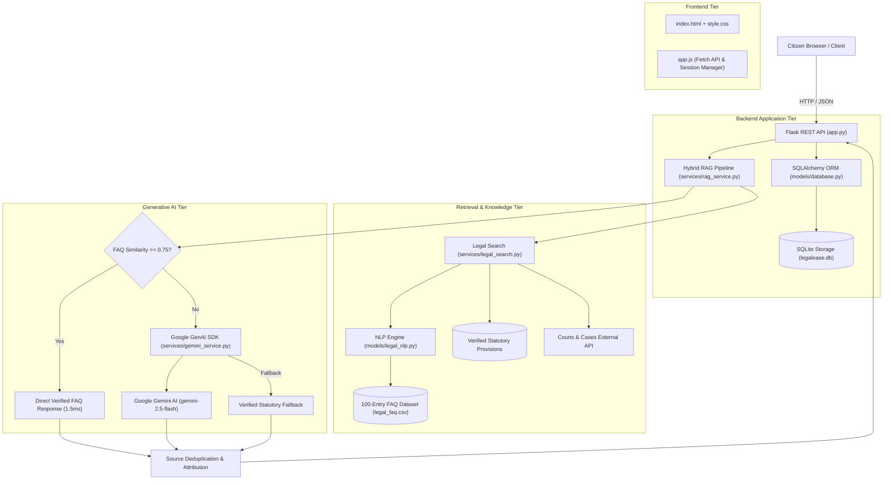

# LegalEase — AI-Powered Indian Legal Awareness Chatbot

[](https://www.python.org/)
[](https://flask.palletsprojects.com/)
[](https://opensource.org/licenses/MIT)
[](#13-how-to-execute-automated-tests)

LegalEase is an intelligent, accessible, and modern AI-powered legal awareness platform designed to make Indian laws, constitutional rights, citizen safeguards, cybercrime reporting, and public dispute remedies simple and accessible in clear English.

> [!IMPORTANT]
> **Legal Disclaimer:** LegalEase provides general legal awareness and educational information regarding Indian laws and public procedures. **It does not provide formal legal advice, judicial representation, or advocate services.** For actionable disputes or litigation, always consult a qualified advocate or your local District Legal Services Authority (DLSA).

---

## Table of Contents

1. [Project Overview](#1-project-overview)
2. [LegalEase Mission and Purpose](#2-legalease-mission-and-purpose)
3. [Key Features](#3-key-features)
4. [User Interface & Screenshots](#4-user-interface--screenshots)
5. [Technology Stack](#5-technology-stack)
6. [System Architecture](#6-system-architecture)
7. [Architecture Diagram](#7-architecture-diagram)
8. [Project Directory Structure](#8-project-directory-structure)
9. [Prerequisites](#9-prerequisites)
10. [Local Windows Installation](#10-local-windows-installation)
11. [Environment Configuration](#11-environment-configuration)
12. [How to Run the Application](#12-how-to-run-the-application)
13. [How to Execute Automated Tests](#13-how-to-execute-automated-tests)
14. [REST API Endpoint Documentation](#14-rest-api-endpoint-documentation)
15. [RAG and NLP Workflow Explanation](#15-rag-and-nlp-workflow-explanation)
16. [Legal Dataset Information & Limitations](#16-legal-dataset-information--limitations)
17. [External API Integration Details](#17-external-api-integration-details)
18. [Security and Privacy Considerations](#18-security-and-privacy-considerations)
19. [Production Deployment Instructions](#19-production-deployment-instructions)
20. [Troubleshooting Guide](#20-troubleshooting-guide)
21. [Mandatory Legal Disclaimer](#21-mandatory-legal-disclaimer)
22. [Future Improvements](#22-future-improvements)
23. [License](#23-license)

---

## 1. Project Overview

Understanding legal rights in India is often hindered by complex legalese, evolving statutes, and fragmented documentation. **LegalEase** bridges this gap by acting as an accessible, everyday AI guide. It translates statutory codes and procedural guidelines into plain, conversational English while grounding all responses in verified Indian legislation and official government portals.

---

## 2. LegalEase Mission and Purpose

- **Democratize Citizen Rights:** Empower citizens to know what rights protect them under the Indian Constitution, Consumer Protection Act, Labor codes, and Cyber laws.
- **Explain New Criminal Codes:** Demystify the historic transition from colonial criminal codes (IPC, CrPC, IEA) to modern legislation (**Bharatiya Nyaya Sanhita (BNS)**, **Bharatiya Nagarik Suraksha Sanhita (BNSS)**, and **Bharatiya Sakshya Adhiniyam (BSA)**) enacted on July 1, 2024.
- **Provide Actionable Procedures:** Provide clear step-by-step guidance on reporting online fraud, filing an FIR, seeking free legal aid, or lodging consumer grievances.
- **Zero Hallucination Standard:** Eliminate fabricated legal claims by prioritizing verified local statutory datasets and official government portals.

---

## 3. Key Features

- **Futuristic Dark-Mode Glassmorphism UI:** Built with custom design tokens (`#0a0e17`, `#111827`, neon blue `#00d2ff`, royal purple `#7928ca`) and `backdrop-filter: blur(12px)`.
- **Hybrid RAG Pipeline:** Intelligent confidence gate ($\ge 0.75$) serving verified FAQs locally in under 2ms, augmenting novel queries with statutory provisions for Gemini synthesis.
- **Multi-Turn Contextual Memory:** Contextual multi-turn dialogue memory passing preceding turns to preserve conversational continuity.
- **Conversation Management:** Create fresh chats, view conversation history, inline rename titles, and delete chats with cascading cleanup.
- **Expandable Verified Sources:** Expandable badges showcasing exact Act names, sections, source types, and verified `.gov.in` / `.nic.in` links.
- **Citizen Helpline Ribbon:** Prominent access to National Helplines: **112** (Emergency), **1930** (Cyber Fraud), **1915** (Consumer Helpline), and **15100** (NALSA Free Legal Aid).
- **Prompt Injection Defense & XSS Sanitization:** Neutralizes adversarial instruction-override attempts and strictly escapes HTML tags before Markdown rendering.
- **Fully Offline Resilient:** Operates seamlessly even when external APIs or cloud AI models are unavailable by engaging local verified repositories.

---

## 4. User Interface & Screenshots

The user interface features a responsive layout optimized for desktop, tablet, and mobile browsers.

```text
+--------------------------------------------------------------------------------------------------+
| [LegalEase Logo] LegalEase                       [New Chat]   | Active: Fundamental Rights       |
+---------------------------------------------------------------+----------------------------------+
|  RECENT CHATS                                                 |                                  |
|  * Fundamental Rights under Constitution                     |  Citizen: What are my rights?    |
|  * Reporting Cyber Fraud via 1930                             |                                  |
|  * Model Tenancy Act Security Deposits                        |  LegalEase: Under Part III of    |
|                                                               |  the Constitution (Articles      |
|  [System Status: Online]                                      |  12-35), you have 6 Fundamental  |
|  [About LegalEase]                                            |  Rights: Right to Equality...    |
|  [Legal Awareness Only • Not Legal Advice]                    |                                  |
|                                                               |  [Verified Legal References (2)] |
+---------------------------------------------------------------+----------------------------------+
|                                                               | [Ask a question about law...] [^]|
+--------------------------------------------------------------------------------------------------+
```

### UI Components Overview
- **Welcome Screen:** Features the scale emblem, national helpline ribbon, and 6 quick-prompt cards.
- **Message Feed:** Distinct user bubbles (slate gradient) and assistant bubbles (glassmorphic dark navy).
- **Expandable Citations:** Shows statute badges (BNS, Constitution, IT Act) and links opening in a secure new tab (`rel="noopener noreferrer"`).
- **Mobile Offcanvas Drawer:** Compact header with hamburger navigation and touch-friendly targets ($\ge 44\text{px}$).

---

## 5. Technology Stack

- **Backend:** Python 3.10+ (tested on Python 3.14), Flask 3.1.2, Flask-CORS 6.0.2.
- **Database & Persistence:** SQLite 3 with SQLAlchemy 2.0.49 ORM (supports thread-safe scoped sessions and cascading deletes).
- **AI & LLM:** Google GenAI SDK (`google-genai` official library) targeting `gemini-2.5-flash` with zero-hallucination system instructions.
- **Natural Language Processing:** Scikit-Learn 1.8.0 (Unigram/Bigram TF-IDF Vectorization, Cosine Similarity), Pandas 2.3.3, NumPy 2.3.4.
- **Frontend:** Semantic HTML5, Bootstrap 5.3.3, Bootstrap Icons 1.11.3, Custom CSS (Glassmorphism), Vanilla JavaScript (ES6+ Fetch API).
- **Production Servers:** Waitress 3.0+ (Windows), Gunicorn 21.2+ (Linux / Container), Docker.

---

## 6. System Architecture

LegalEase follows a modular multi-tier architecture separating presentation, API routing, business logic, retrieval, and persistent storage:

1. **Client Tier:** Browser client with local storage session caching, markdown parser, and responsive drawer.
2. **API Tier (`app.py`):** Flask application factory exposing 6 REST endpoints with CORS and JSON error handling.
3. **Retrieval Tier (`services/legal_search.py`):** Unified search coordinating the NLP FAQ engine and statutory database.
4. **Synthesis Tier (`services/rag_service.py` & `services/gemini_service.py`):** Confidence gating and grounded prompt synthesis with Google Gemini.
5. **Persistence Tier (`models/database.py`):** SQLAlchemy ORM managing `Conversation` and `Message` tables in SQLite.

---

## 7. Architecture Diagram



---

## 8. Project Directory Structure

```text
LegalEase/
├── data/
│   ├── legal_faq.csv                  # 100 verified Q&A pairs covering 20 legal domains
│   └── validate_faq_dataset.py        # Dataset validation script
├── instance/                          # Local SQLite runtime storage (gitignored)
│   └── legalease.db                   # Main SQLite database file
├── models/
│   ├── __init__.py
│   ├── database.py                    # SQLAlchemy 2.0 ORM models (Conversation, Message)
│   └── legal_nlp.py                   # TF-IDF Vectorizer & Cosine Similarity engine
├── services/
│   ├── __init__.py
│   ├── gemini_service.py              # Google GenAI SDK integration with safety rules
│   ├── legal_api_service.py           # Courts & Cases API integration & fallback store
│   ├── legal_search.py                # Unified legal search coordinator
│   └── rag_service.py                 # Hybrid RAG pipeline & confidence routing
├── static/
│   ├── css/
│   │   └── style.css                  # Futuristic dark-mode glassmorphic styles
│   └── js/
│       └── app.js                     # Vanilla JavaScript client & session persistence
├── templates/
│   └── index.html                     # Semantic HTML5 single-page application
├── tests/
│   ├── __init__.py
│   ├── benchmark_performance.py       # Repeatable performance benchmarking script
│   ├── check_legal_api_connection.py  # External API live diagnostic probe
│   ├── test_app.py                    # REST API endpoint tests (26 tests)
│   ├── test_database.py               # SQLAlchemy ORM tests (18 tests)
│   ├── test_frontend.py               # Frontend routes & asset tests (8 tests)
│   ├── test_gemini_service.py         # Gemini service & guardrail tests (24 tests)
│   ├── test_integration_phase10.py   # Multi-turn memory & integration tests (13 tests)
│   ├── test_legal_api_service.py      # Courts & Cases client tests (21 tests)
│   ├── test_legal_nlp.py              # NLP engine & matcher tests (11 tests)
│   ├── test_legal_search.py           # Unified search tests (15 tests)
│   ├── test_phase11_system.py         # System edge cases & security tests (16 tests)
│   └── test_rag_service.py            # RAG pipeline tests (24 tests)
├── .dockerignore                      # Docker exclusion rules
├── .env.example                       # Environment configuration template
├── .gitignore                         # Git protection rules
├── Dockerfile                         # Production multi-stage Dockerfile
├── docker-compose.yml                 # Production container stack specification
├── config.py                          # Centralized application configuration
├── app.py                             # Flask application factory & REST endpoints
├── wsgi.py                            # Production WSGI entry point (Waitress / Gunicorn)
├── requirements.txt                   # Production dependency specifications
└── README.md                          # Comprehensive documentation
```

---

## 9. Prerequisites

- **Python:** Version 3.10, 3.11, 3.12, 3.13, or 3.14.
- **Operating System:** Windows 10/11, Ubuntu/Debian Linux, or macOS.
- **Package Manager:** `pip` (Python package manager).
- **Google AI Studio API Key (Optional for live LLM generation):** [Obtain Key](https://aistudio.google.com/). The application functions fully in offline verification mode without a key.

---

## 10. Local Windows Installation

Open PowerShell or Command Prompt in the `LegalEase` directory:

```powershell
# 1. Navigate to the LegalEase directory
cd C:\Users\HP\OneDrive\Desktop\Stock_Price_Prediction_LSTM\LegalEase

# 2. Create a virtual environment (recommended)
python -m venv venv

# 3. Activate the virtual environment
.\venv\Scripts\Activate.ps1

# 4. Install all production dependencies
pip install -r requirements.txt
```

---

## 11. Environment Configuration

1. Create your local `.env` file by duplicating the provided template:
   ```powershell
   Copy-Item .env.example .env
   ```

2. Open `.env` and set your configuration parameters:
   ```ini
   # Flask Settings
   FLASK_ENV=development
   FLASK_DEBUG=0
   SECRET_KEY=change-this-to-a-secure-random-key-in-production
   HOST=127.0.0.1
   PORT=5000

   # Google Gemini API Key (Optional: Leave placeholder for offline mode)
   GEMINI_API_KEY=your_gemini_api_key_here
   GEMINI_MODEL=gemini-2.5-flash

   # Courts & Cases API
   COURTS_CASES_BASE_URL=https://courtsandcases.com
   COURTS_CASES_API_KEY=optional_api_key_if_subscribed
   EXTERNAL_API_TIMEOUT=5

   # NLP Similarity Threshold (0.0 to 1.0)
   NLP_SIMILARITY_THRESHOLD=0.75

   # Local Database Path
   DATABASE_URL=sqlite:///instance/legalease.db
   ```

> [!CAUTION]
> **Credential Safety:** Never commit `.env` to source control. It is explicitly ignored in `.gitignore`.

---

## 12. How to Run the Application

### Option A: Development Server (Windows / Linux)
```powershell
python app.py
```
*Access the interface at `http://127.0.0.1:5000`.*

### Option B: Windows Production Serving with Waitress
Waitress is a production-quality, multi-threaded pure-Python WSGI server for Windows:
```powershell
waitress-serve --host=127.0.0.1 --port=5000 wsgi:app
```
*To allow other computers on your local area network (LAN) to access the server, change `--host=127.0.0.1` to `--host=0.0.0.0`. Note: LAN access requires opening port 5000 in Windows Defender Firewall and does not make the server publicly accessible on the internet.*

### Option C: Linux Production Serving with Gunicorn
On Linux distributions (Ubuntu, Debian, RHEL):
```bash
gunicorn --bind 0.0.0.0:5000 --workers 4 --threads 2 --timeout 60 wsgi:app
```
*Recommended worker formula: `(2 * CPU_CORES) + 1`.*

### Option D: Docker Container Deployment
```bash
# Build and run with Docker Compose
docker compose up -d --build

# View container logs
docker compose logs -f
```

---

## 13. How to Execute Automated Tests

LegalEase maintains a comprehensive regression test suite of **176 automated tests** with 100% pass rate. All tests run completely offline without making external billable API calls.

```powershell
# Run the entire test suite (176 tests)
python -m unittest discover -s tests -p "test_*.py"

# Run individual test modules:
python -m unittest tests/test_phase11_system.py         # 16 System & security tests
python -m unittest tests/test_integration_phase10.py   # 13 Multi-turn memory tests
python -m unittest tests/test_frontend.py              # 8 Frontend routes & asset tests
python -m unittest tests/test_app.py                   # 26 REST API endpoint tests
python -m unittest tests/test_database.py              # 18 Database ORM tests
python -m unittest tests/test_rag_service.py           # 24 Hybrid RAG pipeline tests
python -m unittest tests/test_legal_search.py          # 15 Unified search tests
python -m unittest tests/test_gemini_service.py        # 24 Gemini AI guardrail tests
python -m unittest tests/test_legal_api_service.py     # 21 API client tests
python -m unittest tests/test_legal_nlp.py             # 11 NLP TF-IDF matcher tests
```

### Running Performance Benchmarks
To measure latency and database integrity on your machine:
```powershell
python tests/benchmark_performance.py
```

---

## 14. REST API Endpoint Documentation

| Method | Endpoint | Description | Request Body | Response (Success) | Status |
| :--- | :--- | :--- | :--- | :--- | :--- |
| `GET` | `/` | Serves the frontend single-page application | None | `text/html` | `200` |
| `GET` | `/api/health` | Service health status and database probe | None | `{"status": "healthy", "service": "LegalEase"}` | `200` |
| `POST` | `/api/chat` | Main legal awareness query endpoint | `{"message": "...", "session_id": "optional-uuid"}` | `{"answer": "...", "sources": [...], "session_id": "..."}` | `200`, `400`, `500` |
| `GET` | `/api/chat/<session_id>` | Retrieves chronological history for a session | None | `{"messages": [...], "message_count": N}` | `200`, `404` |
| `GET` | `/api/conversations` | Lists past conversations with pagination | `?limit=20&offset=0` | `{"conversations": [...], "count": N}` | `200`, `400` |
| `PATCH` | `/api/chat/<session_id>` | Renames a conversation title | `{"title": "New Title"}` | `{"title": "New Title", "success": true}` | `200`, `400`, `404` |
| `DELETE` | `/api/chat/<session_id>` | Cascade deletes conversation & its messages | None | `{"success": true, "message": "Deleted"}` | `200`, `404` |

---

## 15. RAG and NLP Workflow Explanation

1. **Sanitization:** Input length is validated (1 to 1000 characters) and prompt injection regexes intercept adversarial directives.
2. **Intent Short-Circuiting:** Greetings and non-legal queries return immediate rule-based responses without external API calls.
3. **TF-IDF Vectorization:** The query is lowercased, stripped of punctuation, and transformed into a unigram/bigram TF-IDF vector evaluated against all 100 dataset entries.
4. **Confidence Thresholding:**
   - **Score $\ge 0.75$:** Direct fast-path returns the verified FAQ answer in under 2ms.
   - **Score $< 0.75$:** The query is classified as novel or ambiguous and routed to the RAG synthesis path.
5. **Context Assembly:** Relevant statutory provisions (e.g., BNS, BNSS, Consumer Act) and case summaries are retrieved and assembled into a structured prompt.
6. **Grounded Generation:** Google Gemini synthesizes an accessible explanation adhering strictly to Indian legal principles and zero-hallucination rules.
7. **Attribution & Deduplication:** All retrieved statutory and portal sources are deduplicated and attached to the response.

---

## 16. Legal Dataset Information & Limitations

The primary knowledge base resides in [`data/legal_faq.csv`](file:///C:/Users/HP/OneDrive/Desktop/Stock_Price_Prediction_LSTM/LegalEase/data/legal_faq.csv), comprising **100 verified question-answer pairs** across 20 distinct legal domains:

1. Indian Constitution
2. Fundamental Rights (Articles 12–35)
3. Fundamental Duties (Article 51A)
4. Consumer Protection Act, 2019
5. Cybercrime & Online Fraud (IT Act, Helpline 1930)
6. Women's Legal Rights & Protections (Domestic Violence, POSH Act, Zero FIR)
7. Family Law & Maintenance
8. Marriage and Divorce (Special Marriage Act, Hindu Marriage Act)
9. Property and Inheritance Rights
10. Employment & Labour Rights
11. Criminal Law (**BNS 2023** & former IPC)
12. Civil Law & Dispute Resolution
13. Traffic Rules & Motor Vehicles Act
14. Right to Information (RTI Act, 2005)
15. Digital Privacy & Data Protection (DPDP Act, 2023)
16. Banking & Financial Fraud
17. Tenant & Rental Rights (Model Tenancy Act)
18. Legal Complaint Procedures
19. Police Complaint & FIR Procedures (**BNSS 2023** & former CrPC)
20. Legal Aid & Access to Justice (NALSA, Helpline 15100)

### Dataset Limitations
- The FAQ dataset covers core citizen awareness scenarios; it does not cover complex corporate taxation, intellectual property litigation, maritime law, or admiralty jurisdiction.
- Criminal laws distinguish offences prior to July 1, 2024 (tried under IPC/CrPC) from offences committed on or after July 1, 2024 (governed by BNS/BNSS/BSA).

---

## 17. External API Integration Details

### Google Gemini API
- **SDK:** Official `google-genai` Python library.
- **Model:** `gemini-2.5-flash` (configurable in `config.py` via `GEMINI_MODEL`).
- **Temperature:** `0.2` (enforces factual accuracy over creative prose).
- **Safety:** Strict system instructions forbid fabricating section numbers, case names, or foreign citations.

### Courts & Cases API (`courtsandcases.com`)
- Provides Indian case law search, judgment details, and statutory citation lookup.
- When the external service is unreachable (e.g., DNS resolution failure or network sandbox), LegalEase automatically engages its verified local statutory store covering IPC, BNS, CrPC, BNSS, IEA, BSA, and CPC.

---

## 18. Security and Privacy Considerations

- **No Credential Exposure:** API keys and database paths are never returned in JSON payloads, rendered in templates, or leaked into client-side JavaScript.
- **XSS Prevention:** `safeMarkdownToHtml()` applies strict character escaping (`&`, `<`, `>`, `"`, `'`) **before** applying Markdown transformations.
- **URL Protocol Validation:** External links in citations strictly require `https://` or `http://` protocols, actively blocking script injection (`javascript:`, `data:`).
- **External Link Hardening:** All external links include `target="_blank" rel="noopener noreferrer"`.
- **SQL Injection Prevention:** All database operations use parameterized SQLAlchemy ORM queries; raw string concatenation is strictly avoided.
- **Thread Safety:** SQLite connection arguments configure a 30-second busy timeout (`timeout=30`) and `check_same_thread=False` to prevent lock contention.
- **Production Mode:** `ProductionConfig.DEBUG` is strictly set to `False`.

---

## 19. Production Deployment Instructions

### Production Deployment Architecture (Linux / Cloud VM)
In production on a Linux host (e.g., Ubuntu LTS on AWS EC2, DigitalOcean, or Azure VM):

```text
[Internet Users] ---> [Nginx (Reverse Proxy & SSL)] ---> [Gunicorn WSGI (4 Workers)] ---> [LegalEase Flask]
                                                                                                 |
                                                                                         [SQLite Instance DB]
```

#### Step 1: Install System Dependencies
```bash
sudo apt update
sudo apt install -y python3-pip python3-venv nginx curl
```

#### Step 2: Set Up Application & Virtual Environment
```bash
cd /opt/legalease
python3 -m venv venv
source venv/bin/activate
pip install -r requirements.txt
cp .env.example .env
# Edit .env with production SECRET_KEY and optional GEMINI_API_KEY
```

#### Step 3: Create Systemd Service (`/etc/systemd/system/legalease.service`)
```ini
[Unit]
Description=LegalEase AI Legal Awareness Service
After=network.target

[Service]
User=www-data
Group=www-data
WorkingDirectory=/opt/legalease
Environment="PATH=/opt/legalease/venv/bin"
Environment="FLASK_ENV=production"
ExecStart=/opt/legalease/venv/bin/gunicorn --workers 4 --threads 2 --bind 127.0.0.1:5000 wsgi:app
Restart=always

[Install]
WantedBy=multi-user.target
```

#### Step 4: Configure Nginx Reverse Proxy (`/etc/nginx/sites-available/legalease`)
```nginx
server {
    listen 80;
    server_name legal.yourdomain.com;

    location / {
        proxy_pass http://127.0.0.1:5000;
        proxy_set_header Host $host;
        proxy_set_header X-Real-IP $remote_addr;
        proxy_set_header X-Forwarded-For $proxy_add_x_forwarded_for;
        proxy_set_header X-Forwarded-Proto $scheme;
    }
}
```

---

## 20. Troubleshooting Guide

| Issue | Potential Cause | Resolution |
| :--- | :--- | :--- |
| **Port 5000 Already in Use** | Another application or previous Python instance is bound to port 5000. | Change `PORT=5001` in `.env` or run `waitress-serve --port=5001 wsgi:app`. |
| **`google-genai` Not Installed** | Virtual environment is missing dependencies. | Run `pip install google-genai` within your active virtual environment. |
| **Offline Mode Banner in Status Pill** | Network connection is unavailable or host DNS failed. | LegalEase is operating in verified offline fallback mode. Check internet connectivity. |
| **Database Lock Error** | Multiple processes writing to SQLite simultaneously. | Ensure you are running through a single WSGI process with threads or Waitress. The 30s timeout handles concurrency. |
| **Permission Denied on `instance/`** | Web server user lacks write permissions for SQLite. | Run `chmod -R 775 instance` or ensure `instance/` is owned by the service user. |

---

## 21. Mandatory Legal Disclaimer

LegalEase is developed strictly for **educational, awareness, and informational purposes**. It does not constitute legal counsel, attorney-client representation, or judicial determination under the Advocates Act, 1961. 

Laws, statutory provisions, and judicial precedents change over time. Users facing actual legal disputes, pending litigation, or criminal accusations must consult a qualified advocate enrolled with a State Bar Council or contact the National Legal Services Authority (NALSA) Helpline at **15100**.

---

## 22. Future Improvements

- **Multilingual Voice Interface:** Voice recognition and text-to-speech support in major Indian languages (Hindi, Tamil, Telugu, Bengali, Marathi).
- **Document Draft Templates:** Automated generation of standard legal notices, RTI applications, and consumer complaint drafts.
- **Geographic Legal Aid Locator:** Interactive mapping to locate the nearest District Legal Services Authority (DLSA) and Legal Aid Clinics.
- **Judicial Precedent Vector Database:** Embedding database of Supreme Court and High Court landmark judgments using open-source vector embeddings.

---

## 23. License

This project is licensed under the **MIT License**.

```text
MIT License

Copyright (c) 2026 LegalEase Contributors

Permission is hereby granted, free of charge, to any person obtaining a copy
of this software and associated documentation files (the "Software"), to deal
in the Software without restriction, including without limitation the rights
to use, copy, modify, merge, publish, distribute, sublicense, and/or sell
copies of the Software, and to permit persons to whom the Software is
furnished to do so, subject to the following conditions:

The above copyright notice and this permission notice shall be included in all
copies or substantial portions of the Software.

THE SOFTWARE IS PROVIDED "AS IS", WITHOUT WARRANTY OF ANY KIND, EXPRESS OR
IMPLIED, INCLUDING BUT NOT LIMITED TO THE WARRANTIES OF MERCHANTABILITY,
FITNESS FOR A PARTICULAR PURPOSE AND NONINFRINGEMENT. IN NO EVENT SHALL THE
AUTHORS OR COPYRIGHT HOLDERS BE LIABLE FOR ANY CLAIM, DAMAGES OR OTHER
LIABILITY, WHETHER IN AN ACTION OF CONTRACT, TORT OR OTHERWISE, ARISING FROM,
OUT OF OR IN CONNECTION WITH THE SOFTWARE OR THE USE OR OTHER DEALINGS IN THE
SOFTWARE.
```
